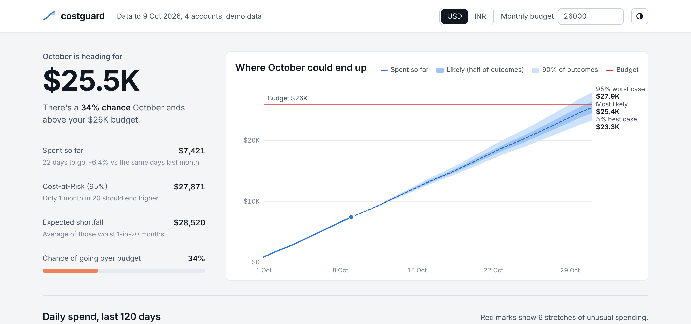
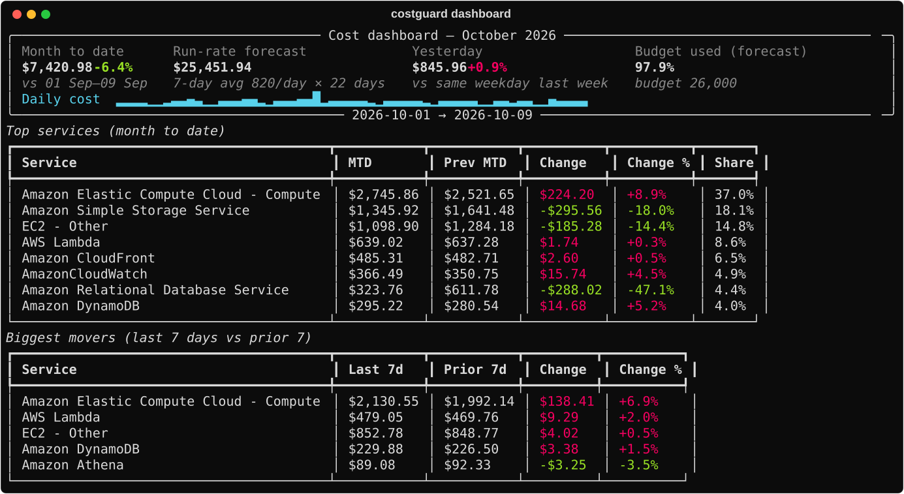
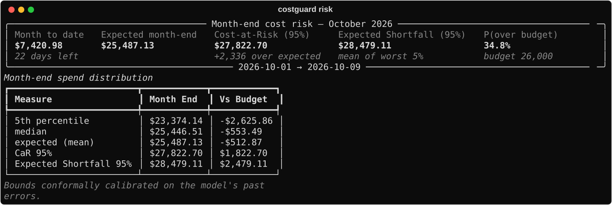
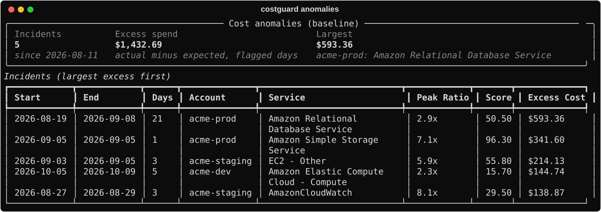
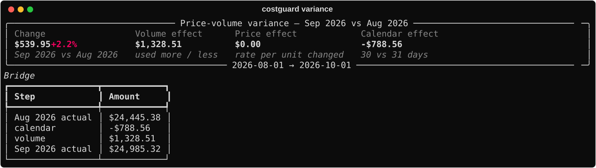
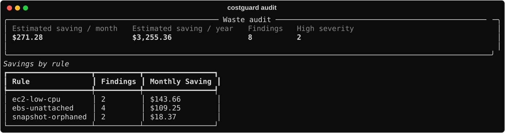
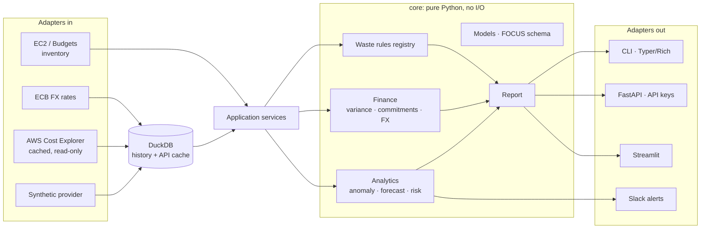

# costguard

[](https://github.com/ronakarun-commits/CostGuard/actions/workflows/ci.yml)


**Cloud cost risk management for AWS: treat the cloud bill like a risk exposure, not just a
number to look at after month-end.**

costguard pulls daily AWS spend across accounts, keeps the history, and answers the questions
a finance or platform team actually asks:

| Question | Command | How |
|---|---|---|
| What are we spending, and where is it moving? | `dashboard`, `trend`, `show` | Month-to-date, run-rate, top services, biggest movers |
| Did something unusual just happen? | `anomalies`, `alert` | Robust per-account×service detection, Slack alerts |
| How bad could this month get? | `risk`, `forecast` | Monte Carlo forecast → **Cost-at-Risk**, **Expected Shortfall**, P(over budget) |
| Can we trust those numbers? | `backtest`, `evaluate` | Kupiec test on past bounds; precision/recall against labelled anomalies |
| *Why* did the bill change? | `variance` | FP&A price-volume-calendar bridge |
| Should we buy a Savings Plan? | `commitments` | Commitment sized as a hedge, NPV of 1y/3y × payment options |
| What does the dollar do to our INR bill? | `fx` | Usage-vs-FX bridge, depreciation stress test, ECB rates |
| What can we switch off? | `audit` | 7 waste rules ranked by $/month |

Everything works **offline on realistic synthetic data** (four accounts, nine services, growth,
weekly seasonality, and labelled injected anomalies), so you can try it without an AWS account.
Connecting to AWS needs only a read-only IAM policy.



<details>
<summary>Terminal version</summary>


</details>

## Quick start

```powershell
# Windows PowerShell (macOS/Linux: same commands)
git clone https://github.com/ronakarun-commits/CostGuard.git
cd costguard
uv sync --all-extras

uv run costguard generate                    # one year of synthetic multi-account data
uv run costguard dashboard --budget 26000
uv run costguard risk --budget 26000
uv run costguard anomalies --all
uv run costguard evaluate                    # score the detectors against the hidden labels
uv run costguard variance
uv run costguard commitments
uv run costguard fx                          # real ECB USD/INR rates (needs internet)
uv run costguard audit -f html -o audit.html
uv run costguard ui                          # web dashboard in your browser
```

Every report can be printed as a table or exported with `-f json|csv|html -o FILE`. Add
`-c INR` to report in rupees.

<details>
<summary>More screenshots</summary>

**Month-end risk**: Cost-at-Risk and Expected Shortfall from 5,000 simulated months



**Anomalies**



**Variance bridge**



**Waste audit**



Sample HTML reports: [`docs/samples/`](docs/samples/)
</details>

## Results (synthetic benchmark)

From [`docs/evaluation.md`](docs/evaluation.md), 5 seeds × 365 days, reproducible with
`scripts/evaluate.py`:

| | |
|---|---|
| Anomaly detection (causal baseline) | **98% precision, 80% recall, F1 88%**, detected within ~1 day |
| Month-end forecast error | **0.4–2.1% MAPE** (forecast made on day 7/14/21) |
| 95% daily risk bounds, raw model | breached 9–17% of days: **Kupiec rejects** on all seeds |
| …after conformal calibration | breached 2–9%; calibration not rejected on 3/5 seeds; month-end 90% coverage 67–85% → 81–96% |

The raw risk model failed its own backtest because Gaussian errors don't capture regime changes
(forgotten resources, incidents). Instead of hand-tuning a heavier tail, the bounds are
conformally calibrated on the model's own past errors. The evaluation shows the before/after.

## Architecture



**Ports and adapters.** `core/` never imports boto3, DuckDB or a UI library, so every number
is unit-testable with synthetic data. Providers implement `typing.Protocol` ports. A thin
`services.py` layer is shared by the CLI, the API and the dashboard, which means one
implementation per use case.

```
src/costguard/
├── core/            models, ports, reports, analytics/, finance/, waste/  (pure)
├── providers/       synthetic, aws/ (Cost Explorer, Budgets, EC2), fx_ecb
├── storage/         DuckDB repository (migrations, idempotent upserts, API cache)
├── interfaces/      render (Rich/JSON/CSV/HTML), api, dashboard_app, notify
├── services.py      use cases shared by every interface
├── config.py        pydantic-settings
└── cli.py           Typer entry point
```

Design decisions and the alternatives considered are recorded as ADRs in [`docs/adr/`](docs/adr/).

## Connecting to AWS

```powershell
aws configure sso --profile costguard          # read-only role, see docs/aws-setup.md
uv run costguard aws whoami --profile costguard
uv run costguard pull --profile costguard --days 90             # ~1-5 requests ≈ $0.01-0.05
uv run costguard pull --detail usage_type --days 90             # enables price/volume split
uv run costguard audit --source aws --profile costguard
```

- **Least privilege**: [`docs/iam-policy.json`](docs/iam-policy.json) has no write actions at all.
- **Cost-aware**: Cost Explorer charges $0.01/request, so every response is cached in DuckDB.
  Recent days expire after 6 h because AWS restates them.
- **No secrets in code**: uses the standard credential chain/SSO only. It warns on root
  credentials, and gitleaks runs in pre-commit and CI.

Details: [`docs/aws-setup.md`](docs/aws-setup.md).

## Running it for real

| | |
|---|---|
| HTTP API | `uv run costguard serve` → `/docs`. Read-only, `X-API-Key` auth (constant-time compare, multiple keys for rotation) |
| Docker | Multi-stage, non-root, healthcheck. `docker compose up api ui` for the demo |
| Daily alerts | GitHub Actions + **AWS OIDC** (no stored keys): `pull` → `alert` → Slack |
| Release | Tag `vX.Y.Z` → tests → PyPI (Trusted Publishing) + GHCR image (amd64/arm64) |

See [`docs/deployment.md`](docs/deployment.md).

## Configuration

Precedence: CLI flags > `COSTGUARD_*` env vars > `.env` > `costguard.toml` > defaults.
See [`costguard.example.toml`](costguard.example.toml). Exit codes are stable for scripting:
`2` config · `3` no data · `4` AWS auth · `5` AWS permission · `6` AWS/API error ·
`10` audit threshold · `11` alerts raised.

## Development

```powershell
uv sync --all-extras
uv run pre-commit install
uv run pytest                  # 190+ tests, ~99% coverage, no network, no AWS
uv run ruff check . ; uv run ruff format . ; uv run mypy
uv run python scripts/evaluate.py > docs/evaluation.md
uv run python scripts/screenshots.py
```

AWS is tested offline with **botocore Stubber** (Cost Explorer) and **moto** (EC2, Budgets,
STS). An autouse fixture hides `~/.aws`, so no test can reach a real account.

## Limitations

- Synthetic data models anomalies; real bills also have credits, refunds, tax and
  month-start charges.
- Savings Plan analysis uses daily data, so intra-day usage variation is ignored and utilisation
  is slightly optimistic. Discounts are approximate.
- Waste savings use a static price table (±10%), which is good for ranking but not for invoicing.
- Single-tenant, single-currency-pair. Not a replacement for a full FinOps platform.

## License

MIT
